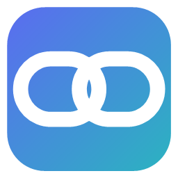
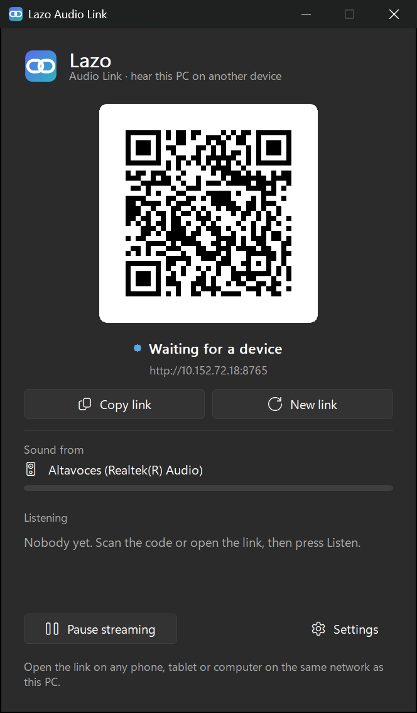
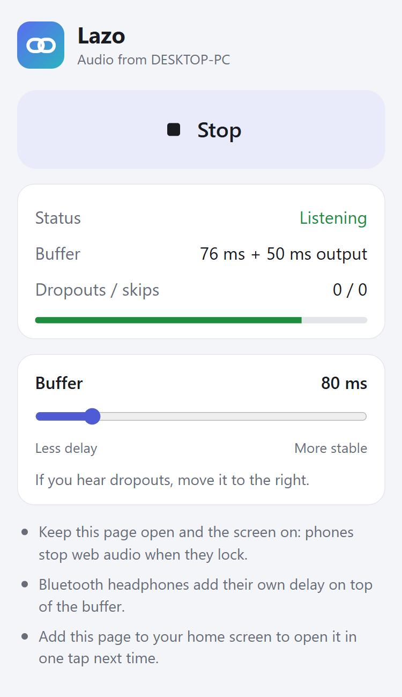

<p align="center"></p>

# 🔗 Lazo — Audio Link
[](https://opensource.org/licenses/MIT)

Hear your PC's sound on your phone, or on any other device with a browser, live over your home network. 🎧  
Watching a video on a desktop PC without Bluetooth? Open Lazo, scan its QR code with your phone, tap **Listen**, and the sound plays in the headphones connected to your phone, with a delay of about a tenth of a second. A tablet or a laptop works the same way: just open the link.

**Nothing to install on the other device**, no accounts, no cloud: the sound goes straight from the PC to it on your local network.

<p align="center">&nbsp;&nbsp;</p>

---

## 🚀 Features

- 🔊 **Everything the PC plays**: Lazo records what goes to your speakers (or any output you choose) and sends it to the other device, in stereo
- 📷 **Scan and listen**: a QR code with the PC's address; any phone camera opens it, in Safari on iPhone or Chrome on Android. On a laptop or tablet, open the link
- ⏱️ **Low delay, clean sound**
  - Around 80 ms of buffer by default, adjustable on the listening device from 40 to 300 ms (less delay ↔ more stable)
  - Plays as one continuous stream, so there's no crackle between packets
  - Follows the small clock difference between the PC and the listening device by speeding up or slowing down imperceptibly (±0.3 %), never by dropping audio
  - Silence keeps flowing while nothing plays, so the sound starts instantly when it comes back
- 📊 **Live status on the listening device**: connection, buffer, dropouts and skips, and a level meter
- 🔇 **Mute this PC while a device listens** (optional): the speakers go quiet and the other device still gets the sound
- 📱 **Several devices at once**, each listed in Lazo's window with how long it has been listening
- 🔁 **Follows your outputs**: switch the default speakers in Windows and Lazo follows at once; unplugged devices are picked up again when they come back
- 🔒 **Private by design**
  - Every connection needs the secret key in the QR code. **New link** changes it at once
  - Only devices on your private network (home Wi-Fi) can connect, and only Lazo's own page can open the audio stream
  - Optionally pauses after 15, 30 or 60 minutes with nobody listening
  - The PC's sound is only recorded while a device is listening
- 🏠 **Add the page to your home screen**: the link stays the same, so it opens in one tap next time
- 🌐 Changed Wi-Fi? Lazo notices and shows the new address
- 🌙 Clean Windows 11 look that follows your light or dark theme and accent color; the listening page follows the device's theme too
- 🪶 Tiny: a ~0.7 MB program, a ~2.3 MB installer, no .NET or Visual C++ runtime needed

---

## 📦 Install

Download `LazoSetup.exe` from [Releases](https://github.com/VitomDev/Lazo-Audio-Link/releases/latest) and run it.

> 🧰 **Recommended:** install it with [Vitool Box](https://github.com/VitomDev/Vitool-Box), which keeps all VitomDev apps in one place and installs or removes them with a switch.

- Per-user install, no admin rights needed
- 🛡️ The first time Lazo starts, **Windows Firewall** asks whether it may use the network: allow it on **Private networks** (home Wi-Fi). Public networks aren't needed
- Lazo doesn't start with Windows unless you turn it on in **Settings**

Uninstalling (Settings → Apps) removes Lazo, its startup entry and its settings.

---

## 🖱️ Usage

| Action | How |
| --- | --- |
| Listen on a phone | Open Lazo, scan the QR code with the phone's camera, tap **Listen** |
| Listen on a laptop or tablet | Open the link shown in Lazo (**Copy link**) in its browser, click **Listen** |
| Less delay or fewer dropouts | Move the **Buffer** slider on the listening device (left: less delay, right: more stable) |
| Copy the link | **Copy link** in the window, or right-click the tray icon → **Copy link** |
| Stop old links from working | **New link** (devices must use the new code or link) |
| Pause or resume streaming | **Pause streaming** in the window, or from the tray icon's menu |
| Keep Lazo running | Close the window: Lazo stays in the notification area |
| Open the window again | Click the tray icon, or start Lazo again |
| Settings | **Settings** in the window, or right-click the tray icon → **Settings** |
| Exit | Right-click the tray icon → **Exit Lazo** |

🎧 Bluetooth headphones add their own delay (often 100–200 ms) on top of Lazo's buffer.

### ⚙️ Settings

- **Send the sound of**: the default output (follows Windows) or a specific one
- **Mute this PC while a device listens**
- **Port**: 8765 by default; if it's taken, Lazo tries the next ones
- **Pause when nobody listens**: never, or after 15, 30 or 60 minutes
- **Notify when a device connects**
- **Start with Windows**

---

## ⚡ Performance

Measured on the development PC (Windows 11):

| | |
| --- | --- |
| CPU while streaming to one device | 0.9 s over 60 s (about 1.5 % of one core) |
| CPU while waiting in the notification area | 0 ms over 60 s |
| Memory | 3–4 MB private, 18–20 MB working set |
| Network | ~1.5 Mbit/s per listening device (48 kHz, 16-bit stereo, uncompressed) |
| `Lazo.exe` / installer | 0.7 MB / 2.3 MB |

---

## 🔧 Build

Requirements: Visual Studio 2022 or newer with the C++ x64 tools and Inno Setup 6 (`winget install JRSoftware.InnoSetup`).

```powershell
.\build.ps1
```

It downloads the pinned build dependencies into `.deps/` (Windows SDK, CMake, Ninja and ZXing-C++, all verified by hash), builds everything, runs the tests and writes the installer to `dist/LazoSetup.exe`.

`.\build.ps1 -SkipTests` and `.\build.ps1 -SkipInstaller` skip those steps.

---

## 📚 Dependencies

- [ZXing-C++](https://github.com/zxing-cpp/zxing-cpp) — creating the QR code
- Windows Audio Session API (WASAPI loopback) — recording what the PC plays
- Windows Sockets — the small built-in web and WebSocket server, no HTTP library

See [third-party notices](THIRD-PARTY-NOTICES.md) for licenses.

---

## 🪟 Compatibility

Windows 10 (version 1809 or newer) and Windows 11, 64-bit.  
Listening devices: Safari on iPhone and iPad (iOS 15 or newer), Chrome on Android, or any current browser on a laptop or PC on the same network.

---

## 🧪 Project Status

🚧 In development.  
The first version works; more features are on the way.

---

## 📄 License

[MIT](LICENSE) © VitomDev

---

## 📲 Contact

Feel free to reach out or follow me:

- 🐙 GitHub: [@VitomDev](https://github.com/VitomDev)
- 🐦 Twitter/X: [@VitomDev](https://twitter.com/VitomDev)
- 🎮 Twitch: [@VitomDev](https://www.twitch.tv/VitomDev)
- 💼 LinkedIn: [VitomDev](https://www.linkedin.com/in/víctor-escós-batalla/)
